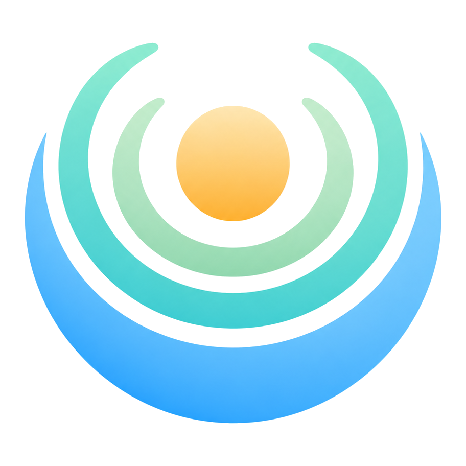
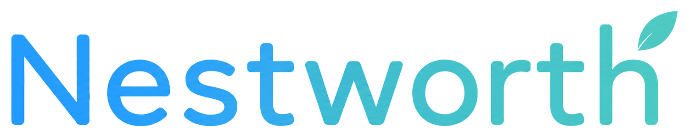
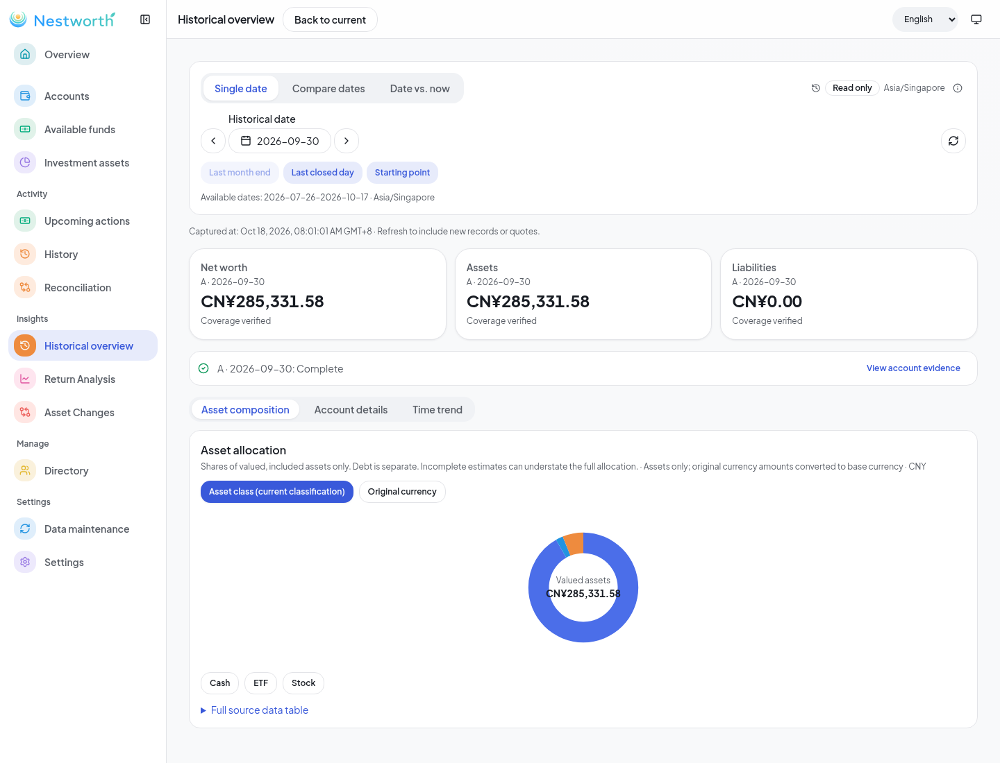
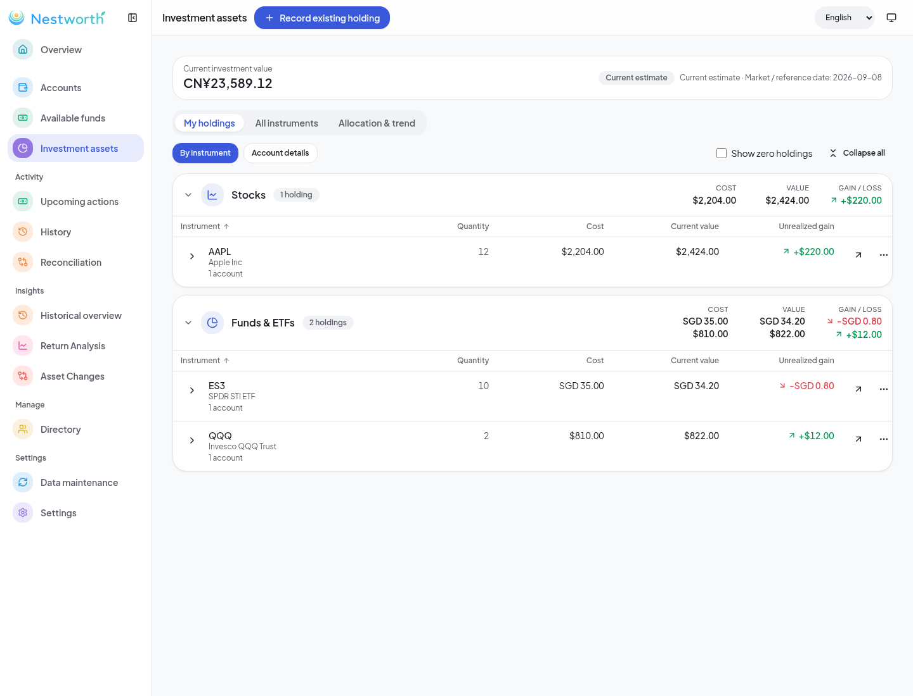
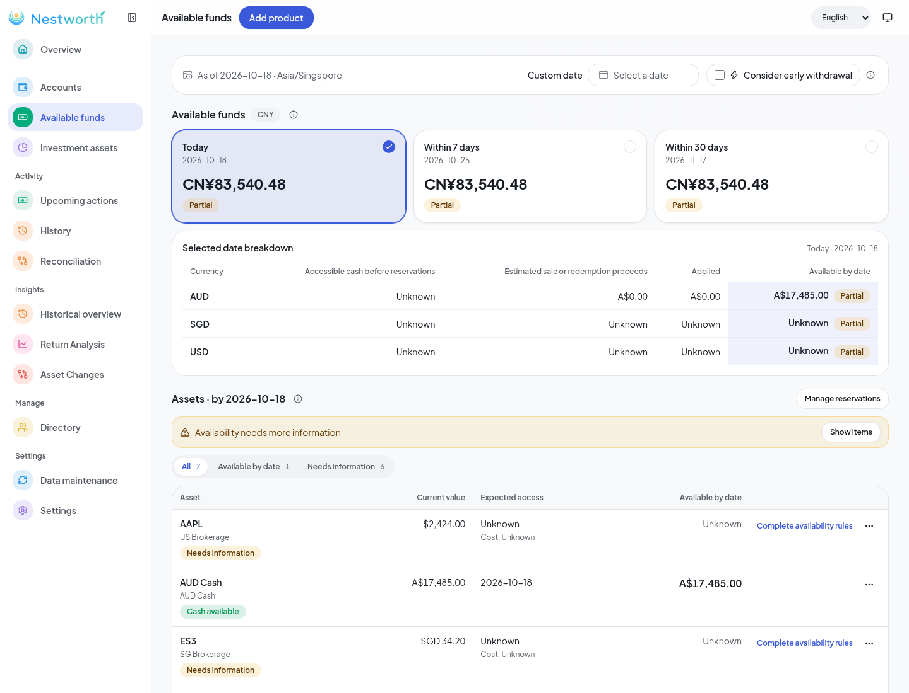

<p align="center">
  
</p>
<p align="center">
  
</p>

<h3 align="center">Your wealth. In perspective.</h3>

<p align="center">
  A private home for your household finances.<br>
  See what you own, understand what changed, and keep your data on your Mac.
</p>

<p align="center">
  <a href="https://github.com/MnemosyneLab/NestworthGo/releases"></a>
  <a href="https://github.com/MnemosyneLab/NestworthGo/actions/workflows/check.yml"></a>
  <a href="LICENSE"></a>
  
</p>

<p align="center">
  <a href="https://github.com/MnemosyneLab/NestworthGo/releases/latest"></a>
</p>

<p align="center">
  <a href="#a-closer-look">Explore</a> ·
  <a href="#get-started">Get started</a> ·
  <a href="docs/README.md">Documentation</a> ·
  <a href="#build-it-yourself">Build from source</a> ·
  <a href="CHANGELOG.md">Changelog</a>
</p>

<p align="center">
  
</p>
<p align="center">
  <sub>A clearer view of your balance sheet, across accounts, currencies and time.</sub>
</p>

## A complete picture, on your terms

Cash in one bank. Investments in another currency. A shared account, a term
deposit, a loan. Nestworth brings the pieces into one household balance sheet,
with the history and evidence behind the numbers.

**Local first. No registration. No required cloud account.** Core browsing and
editing work offline. Market refresh and optional cloud backup happen only
when you choose to use them.

<table>
  <tr>
    <td width="50%" valign="top">
      <h3>◈ Your whole balance sheet</h3>
      <p>Bring assets, liabilities, accounts and holdings together. Explore ownership by household member, institution or your own groups.</p>
    </td>
    <td width="50%" valign="top">
      <h3>↗ Understand your returns</h3>
      <p>Explore realized and unrealized gains, cost basis and contribution detail. Separate investment performance from currency movement.</p>
    </td>
  </tr>
  <tr>
    <td valign="top">
      <h3>◷ Travel through your history</h3>
      <p>Revisit a dated balance sheet, compare captured dates and inspect the evidence behind historical values.</p>
    </td>
    <td valign="top">
      <h3>◎ Know what is available</h3>
      <p>Explore accessible funds by date, including reservations, term deposits and locked products. Keep missing information visible.</p>
    </td>
  </tr>
  <tr>
    <td valign="top">
      <h3>✓ Keep the details in order</h3>
      <p>A unified Tasks hub brings upcoming actions, investment reviews and account reconciliation together, with explicit previews and audited corrections.</p>
    </td>
    <td valign="top">
      <h3>✦ Work with your AI tools</h3>
      <p>Connect Codex through local MCP. Choose read-only, directory-maintenance or ledger-writing permissions, with a separately installed Nestworth skill.</p>
    </td>
  </tr>
</table>

## A closer look

<table>
  <tr>
    <td width="50%">
      
    </td>
    <td width="50%">
      
    </td>
  </tr>
  <tr>
    <td><strong>A portfolio with context.</strong><br>Holdings, currencies, cost and performance in one place.</td>
    <td><strong>Liquidity with the details attached.</strong><br>See what is available and which inputs still need attention.</td>
  </tr>
</table>

<sub>Screenshots show synthetic demo data from October 2026 browser builds;
current navigation may differ. [Screenshot source and scope](docs/qa/post-merge-pr101-pr102-2026-10-17/REPORT.md).</sub>

## Get started

Download the **Apple Silicon DMG or ZIP** from
[GitHub Releases](https://github.com/MnemosyneLab/NestworthGo/releases/latest).
The current release is **v0.3.9 · build 10**, published October 21, 2026.
Checksums are included with the downloads.

| Before you install | Current release |
| --- | --- |
| Platform | macOS **27.0 or newer**, Apple Silicon (arm64) |
| Signing | Ad-hoc signed; **no Developer ID signature or notarization**. macOS may warn or block the app. |
| Existing databases | Supports verified **schemas 21 and 22**. **v0.3.8's schema 16 cannot be opened directly.** Preserve your original database and backups. |
| Verification | Package integrity and uploaded assets verified. Native GUI/accessibility and archive-launch acceptance are owner-deferred; schema recovery, test-ledger and external-client acceptance were not run. |

The only supported database upgrade is verified **21 → 22**, with a retained,
verified read-only recovery copy. Older, unversioned, malformed and future
databases are rejected. See [storage and recovery](docs/architecture/data-and-ipc-contracts.md#database-support-and-storage-recovery)
and the [full release record](docs/releases/v0.3.9.md) before upgrading.

### Bring Codex along

Connect a local client in **Settings → AI / MCP**, then install the optional
[Nestworth skill](docs/user/nestworth-skill.md). From a repository checkout:

```bash
bash tools/install-nestworth-skill.sh
```

Standalone skill **1.11.0** is also included in the v0.3.9 release. Installing
it does not enable MCP, grant permissions or change financial records.

## Built around your data

- **Local SQLite is the source of truth.** No registration or network access
  is required for core use.
- **Exact financial arithmetic.** Decimal amounts, explicit coverage and
  traceable corrections; missing values remain unknown.
- **Refresh on your terms.** Yahoo, Tiingo, CoinGecko, Frankfurter FX and
  Agent-supplied observations support sourced market data. Refresh is
  user-triggered.
- **Recovery you control.** Local backup/restore, versioned JSON export and
  opt-in continuous backup to your Cloudflare R2 while the app runs.
  [Read the backup guide](docs/development/continuous-backup.md).

Nestworth focuses on household wealth. Brokerage order execution, direct
bank/brokerage integrations, multi-device sync and automatic market refresh
are outside the current release. JSON exports are for external tools, not
restorable backups; CSV import/export is not available.

## Build it yourself

**Go 1.27.3+ · Node.js 24.22.0 · pnpm · Wails CLI v3.0.0-beta.34**

Native Mac builds require Apple Silicon, macOS 27+ and a macOS 27 SDK.

```bash
git clone https://github.com/MnemosyneLab/NestworthGo.git
cd NestworthGo
wails3 task setup
wails3 task dev
```

`setup` installs dependencies and generates Wails bindings; `dev` starts the
Go rebuild loop, Vite and the desktop shell.

| Command | Purpose |
| --- | --- |
| `wails3 task check` | Go and frontend validation |
| `wails3 task build` | Production desktop binary |
| `wails3 task package:release` | Native arm64 app, DMG, ZIP, manifests and skill bundle |

For platform dependencies, isolated synthetic-data testing and signing gates,
follow the [local development guide](docs/development/local-workflow.md).

<details>
<summary><strong>Under the hood</strong></summary>

<br>

Go owns financial calculations, validation and persistence. A Wails v3 shell
hosts a React + TypeScript frontend, with SQLite, exact decimal arithmetic,
TanStack Query/Table and Apache ECharts.

| Area | Start here |
| --- | --- |
| Product and workflows | [Product vision](docs/product/product-vision.md) |
| Architecture and data | [System overview](docs/architecture/system-overview.md) |
| Development | [Engineering guide](docs/development/engineering-guide.md) |
| All documentation | [Documentation index](docs/README.md) |

</details>

## Contributing

Bug reports, thoughtful feature requests and focused pull requests are welcome.
[Open an issue](https://github.com/MnemosyneLab/NestworthGo/issues) or read the
[engineering guide](docs/development/engineering-guide.md) before making a change.
Use synthetic data in reports and screenshots; keep personal financial data
and credentials private.

---

<p align="center">
  <br>
  <strong>Your household. Your history. Your data.</strong><br>
  <sub>MIT licensed · <a href="LICENSE">Nestworth contributors</a></sub>
</p>
