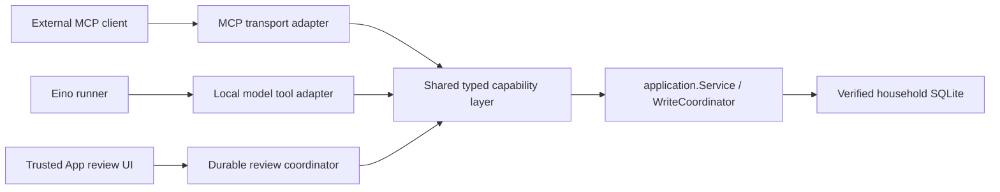

# Built-in AI integration and delivery boundaries

## Current delivery: shared capability prerequisite

This is a prerequisite stage, **not a working built-in App assistant**. There is
no desktop assistant entry point, mobile assistant route, provider configuration,
model request, credential store or production Eino runner in this change. The
existing external MCP remains enabled according to its existing settings and
permissions; it does not acquire an App confirmation requirement.

The target remains a complete desktop and mobile read/write assistant. A staged
delivery is necessary because shipping the existing model adapter or treating a
chat response as approval would fail known safety requirements. The in-process
read surface is an internal prerequisite, not a replacement read-only product.

Implemented and exercised with synthetic data:

- `internal/agentcapability` owns typed tool definitions, schema construction,
  explicit effects, detached metadata and validated direct dispatch. It imports
  no MCP SDK, HTTP client, model runtime or database package.
- All existing business tool registrations use that registry. The MCP adapter
  retains the existing SDK's typed input validation/defaults/decoding, errors,
  output validation and structured/text envelopes. Business handlers still live
  in `internal/mcpserver`; extracting their storage/lifecycle owner into a
  separate capability core is subsequent work. The registration extraction is
  complete; the entire package separation is not.
- Normal external MCP uses the shared registrations. Immutable discovery
  fingerprints from unmodified main `1701e5d5d9bb10ec9db846245766bab6f7a740e5`
  cover all metadata and schemas in its 54/73/103-tool modes. Typed prior-adapter
  comparisons cover successful output, business errors, unknown tools, missing,
  wrong-type, extra, null, array and malformed/trailing arguments. Existing HTTP
  envelope, pagination, plan and receipt regressions remain in place.
- `NewInProcessSession` builds the same handlers directly, without opening a
  listener, creating an MCP client, reading a bearer token or making loopback
  HTTP requests. It reuses the caller's `application.Service` and its existing
  `WriteCoordinator`. Mode, process identity, capture keys/generation and
  revocation are separate from external MCP. External disable does not stop it.
- Each local session uses a host-owned UUID and a disjoint household/session
  storage namespace, `builtin_ai.capability.v1.<household>.<session>.`, or a
  corresponding private file directory. Existing `mcp.*` settings, previews and
  operation receipts are unchanged. One live owner per application/household/
  session is enforced; callers must continue to use the single application
  service for a live database, not create parallel service owners.
- Public local discovery/calls exclude every explicit `write` effect and every
  open-world/provider capability. Read, derived analysis and private previews
  are available according to the independently selected mode. Preview creation
  is never approval. An unexported trusted test path verifies real business
  preview/commit parity; **it is not a production approval mechanism** and has
  no Wails/mobile/model/chat entry point.
- Local requests and delivered JSON are bounded to 64 KiB. Existing business
  page limits, frozen capture hashes, fixed expiry and evidence continue to
  apply. Local generic JSON validation preserves numeric lexemes; integer
  validation never round-trips through float64. The pinned schema library's
  finite nonintegral-number validation uses a detached numeric view. Unsupported
  integer ranges or numeric forms that would change integer/noninteger type
  are refused. Financial inputs and results continue to use exact decimal
  strings. External SDK numeric semantics are unchanged.
- Synthetic tests cover concurrent identical ledger commits, exact resulting
  cash and a single activity, successful receipt recovery after SQLite/application
  reopen, rejected old uncommitted previews and conservative unknown directory
  outcomes. They also cover cross-session/external receipt and cursor isolation,
  model write denial, cancellation and an in-flight restore revocation fence.

These tests do not prove power-loss durability, arbitrary multi-process writers,
full process-crash recovery, backup/restore acceptance or any App review flow.
There are no exactly-once transport claims. A cancelled request after a known
successful commit still has its successful receipt. An interrupted admitted
write without a proven result is unknown and requires receipt inspection with
the original identity. Neither cancellation nor chat deletion reverses a write.

## Model-provider production gates remain closed

The experiment in [draft PR #192](https://github.com/MnemosyneLab/NestworthGo/pull/192),
source `c13313237f279dc56d9237047e187d1787882e95`, exercises the real Eino
runner and Responses converter with a fake HTTP/SSE provider and synthetic ledger.
Its current released combination is Eino `v0.9.22` and agenticopenai `v0.2.4`.
On 2026-11-04, querying the Go module proxy's `@latest` still resolved those
versions; rerunning strict acceptance against current main reproduced both gates:

| Strict acceptance case | Result |
| --- | --- |
| Complete call arguments followed by EOF before item done | Tool dispatched; one synthetic mutation; FAIL |
| EOF after item done but before response completed | Tool dispatched; one synthetic mutation; FAIL |
| `response.failed` after complete call arguments | Tool dispatched; one synthetic mutation; FAIL |
| Partial arguments or malformed event JSON | Zero mutations in these fixtures |
| Encrypted reasoning arriving only at `output_item.done` | Encrypted content lost; FAIL |

Reproduce in that experiment's nested module, using its pinned dependencies:

```sh
EINO_REQUIRE_PROVIDER_SAFETY=1 go test -count=1 -timeout=60s -v \
  -run 'TestRawStreamFailureCharacterization|TestReasoningArrivingOnlyAtItemDone' ./...
```

No transport change in this delivery fixes or bypasses those failures. No paid
provider requests or real keys were used. The experiment's buffered completion
gate, checkpoint files and simulated approvals are not production components.

A production adapter must separately gate tool dispatch on a fully parsed,
successfully completed response, EOF/trailing framing and explicit failure state,
with byte/event/time bounds and cancellation. Display streaming is provisional
and may proceed independently; it must not release executable tool arguments.
The adapter must retain opaque reasoning from both added and done events, preserve
item identity/order, and round-trip it into the next real Eino model request.
The two strict tests must pass against the corrected actual converter/runner,
including an otherwise-valid tool response. Silencing the failing cases, changing
only the tool transport or using a stub model is not acceptance.

## Intended runtime and authority boundaries



The diagram describes the target. The local model adapter, durable review
coordinator and App assistant UI are not installed in this stage. No model gets
arbitrary SQL, repository access, reflection over Wails methods, general HTTP
tools or a way to manufacture a host approval.

Every production principal must bind the ledger incarnation, host session and
permission revision. Built-in enable/revoke, provider credentials, data scope and
conversation state must remain separate from external MCP token/mode/enable.
Capture caches and continuation cursors must be principal-bound and revoked on
scope changes. Minimal financial disclosure hides identities; it is not an
account permission boundary. Scoped reads must compute allowed totals, gaps,
evidence and pages from the permitted input set, never filter only returned rows.

Mobile authority is the intersection of the *current* authenticated mobile
session's read/record/market/manual capabilities and built-in permissions, checked
again at dispatch and confirmation. The present in-process session is household-
wide and must not be exposed to mobile/scoped principals until that enforcement
exists. Mobile session expiry/revocation must cancel runs and fence confirmations.

Restore integration must register local-session revocation alongside external
MCP **before** replacing database state, under the existing restore lifecycle.
`RevokeForRestore` cancels/fences without draining a writer while the application
owns its exclusive permit; `Close` drains only outside that permit. The current
per-call household check alone cannot close a restore race and is not automatic
restore integration. Restored configuration, cached evidence and approvals must
not regain authority; rebind to a fresh incarnation and require new previews.

## Durable host review and write protocol to implement

The model produces a structured proposal only. Trusted App code obtains the
authoritative preview from the capability layer and renders the exact business
effects, account/instrument labels, values, currencies, effective dates and missing
evidence. Raw model text and summarized chat history are not review authority.

The host must persist a versioned review record binding ledger/incarnation,
session/principal and permission revision, tool/write family, immutable arguments
and digest, authoritative preview and its version, plan identity, expiry and
operation ID. Only a deliberate action on that review in trusted App UI may
transition it to confirmed. The model tool inventory must contain no approve,
confirm or capability for constructing an approval credential. All writers,
including directory/configuration writes, require this boundary for built-in AI.
External MCP retains its present behavior.

Changed parameters, stale business state, permission changes, expiry, application
restart or restore invalidate an uncommitted review. Re-preview and show a fresh
review before another confirmation. Retain the immutable identity for a pending
or unknown commit; prevent edits, navigation dismissal and a second dispatch.
Repeat clicks and timeout recovery inspect/retry the *same* operation/plan.
Existing transaction-backed ledger receipts can recover successful outcomes.
Directory/configuration writes with unknown outcomes cannot be blindly replayed.

Cancellation before dispatch produces no dispatch; cancellation while committing
does not establish rollback. The persisted run/review state must distinguish
cancelled-before-commit, known committed and unknown outcome. Switching ledgers
never carries authorization forward. Receipt retention is independent of message
and conversation deletion.

## Conversation, provider and UI follow-up plan

Implement in dependency order, with each stage independently reviewable:

1. **Capability ownership and principals.** Move the remaining transport-neutral
   business/cache/receipt owner out of `mcpserver`; preserve external compatibility
   tests. Add ledger incarnations, account-scope enforcement and live mobile
   permission intersection. Hook shutdown, ledger change and restore revocation.
2. **Versioned durable host state.** Add approved SQLite migration/recovery rules
   for conversations, messages, runs, proposals/reviews and evidence snapshots.
   Persist receipt references independently. Define CAS transitions, schema
   upgrades and fail-closed future/corrupt versions. Restart must not rerun paid
   model requests or unknown writes automatically. Reconcile receipts first;
   uncommitted reviews require new preview/confirmation.
3. **Provider acceptance and credentials.** Correct and pass both real Eino gates
   before production activation. Add the in-process tool adapter and bounded
   provider runner; disable implicit retries and remote storage/caching by default.
   Validate HTTPS target origin, model and redirects; do not forward credentials
   across origins. Prefer native system secure storage with explicit unavailable/
   locked states; no silent plaintext fallback. APIs return key presence/status
   only, never the secret. Keep secrets out of logs, diagnostics, exports, tools,
   prompts, checkpoints and frontend responses. Test redaction with canary keys.
4. **Desktop host review and assistant.** Reuse AppShell, Sheet, AlertDialog,
   Button/Input/NativeSelect and query/mutation infrastructure. Add an assistant
   entry, side conversation and expanded long-conversation workspace. Account,
   holdings, activity and historical pages send structured navigation context
   (stable typed targets and selected scope/date), not scraped page text. Run
   authoritative reads for facts; show expandable evidence/time/scope/currency,
   missingness and pagination with business-page links. Saved evidence is an old
   snapshot, not a live balance. Never turn missing data into zero. Implement
   host review from the protocol above before enabling any writer.
5. **Mobile host review and delivery.** Use an accessible touch-sized full-screen
   conversation and review flow. Keep the central recording button. Expose only
   session-intersected tools and data, reconnect without auto-replaying model
   requests or writes, and bind each review to the current mobile session. Keep
   built-in settings visibly separate from external MCP settings; show provider,
   model, key status, selected data scope and permissions. Localize English,
   Simplified Chinese and Traditional Chinese. Cover empty/error/rate-limit,
   cancel/disconnect, keyboard, focus restoration and screen-reader states.
6. **End-to-end release gates.** Fake-provider tests must exercise complete
   desktop/mobile read -> proposal -> trusted review -> commit -> receipt/read
   loops, permission/scope changes, pagination, concurrent confirmations,
   cancellation, interrupted model streams, provider errors, process crashes,
   SQLite reopen, backup/restore and credential canaries. Run tests and builds
   separately. Native macOS GUI/a11y, secure storage, packaging and real-provider
   compatibility need named evidence; Linux/jsdom and simulated approvals cannot
   substitute. No real ledger, screenshot, key or paid call is necessary for the
   synthetic acceptance gate.

Until these dependent gates are complete, do not add an enabled assistant UI,
accept an API key or expose the trusted write path as a model tool.
