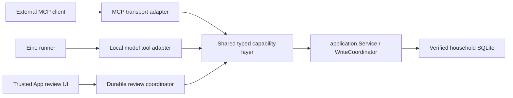

# Built-in AI integration and delivery boundaries

## Current delivery: page guide UI, general AI activation still closed

The installed UI follow-up is documented in [Page guide stage](builtin-ai-page-guide.md).
It adds a local deterministic guide on desktop and mobile, typed in-memory page
publications and explicit account navigation, plus closed capability-status APIs.
It does not activate a model, credentials, durable conversations or AI writes.
The complete read/write assistant remains the target. The backend integration
core described below is the prior stage merged through #203.

## Host review backend integration stage

The target is a complete desktop and mobile read/write assistant, including
structured current-page explanations and semantic navigation. This delivery is
an independently testable **backend vertical stage**, not a working App assistant
or a permanent read-only product.

Base main `76722b33477f45aed4babffaa0d33664098c3f7d` includes merged #199
(shared capabilities), #201 (completion-gated Responses model) and #200
(desktop Back/Forward/Recent navigation). This stage adds:

- A reusable Eino `CapabilityTools` adapter over the model-facing in-process
  session. It validates closed-world, non-writing discovery, rejects lossy schema
  conversion, returns detached metadata and rechecks the session at dispatch.
  It never calls a local HTTP/MCP endpoint. Root runtime dependencies stay unchanged.
- A durable, versioned host review coordinator for single `commit_change` ledger
  operations. It independently prepares a preview, binds immutable authority,
  admits once, commits through the existing application gate, and inspects both
  outer and transaction-backed receipts without redispatch after interruption.
- A reserved business receipt keyspace for local `import_market_data`:
  `builtin_ai.v1:<household UUID>:<host session UUID>:<operation UUID>` (124 bytes).
  The database has a global request-key primary key plus a household ownership
  check. External callers still accept only UUIDs and cannot select the reserved
  keys even when the exact local identities are known. Local UUID case aliases
  normalize to the same receipt; external keys/schemas/behavior remain unchanged.
  Import is still unavailable to public local/model calls and host reviews.
- An acceptance gate with the actual Eino runner, guarded model, fake loopback
  provider, shared local handlers and synthetic SQLite: read -> proposal -> new
  host preview -> explicit synthetic host confirmation -> commit -> receipt/read.
  Failed/truncated/incomplete proposal responses dispatch zero preview calls.
  Native reasoning is replayed on the next actual provider request.

The backend stage added no application service registration, Wails method, mobile
endpoint or assistant UI. The page guide follow-up adds only capability-status
entry points and local UI; no runner, API-key input or secret store is installed. The provider module is
still not imported by the executable. There is no activation flag to turn on:
the product entry points do not exist. The host APIs are integration components,
not proof of trusted GUI approval. Complete model-backed desktop/mobile UI, live mobile intersection,
conversation/run persistence, system credential storage, startup/restore wiring,
packaging and live-model compatibility remain required before activation.

Implemented and exercised with synthetic data:

- `internal/agentcapability` owns typed tool definitions, schema construction,
  explicit effects, detached metadata and validated direct dispatch. It imports
  no MCP SDK, HTTP client, model runtime or database package.
- All existing business tool registrations use that registry. The MCP adapter
  retains the existing SDK's typed input validation/defaults/decoding, errors,
  output validation and structured/text envelopes. Business handlers still live
  in `internal/mcpserver`; extracting their storage/lifecycle owner into a
  separate capability core is subsequent work. The registration extraction is
  complete; the entire package separation is not.
- Normal external MCP uses the shared registrations. Immutable discovery
  fingerprints from unmodified main `82f3be0e981d5cd3a8cdaae061a4b76b179b8c29`
  cover all metadata and schemas in its 54/73/103-tool modes. The updated capture
  retains upstream #198's two historical-overview description revisions relative
  to the initial `1701e5d` baseline; tool schemas are unchanged. Shared/external
  instructions also retain `endpoint_bridge/2`. Typed prior-adapter
  comparisons cover successful output, business errors, unknown tools, missing,
  wrong-type, extra, null, array and malformed/trailing arguments. Existing HTTP
  envelope, pagination, plan and receipt regressions remain in place.
- `NewInProcessSession` builds the same handlers directly, without opening a
  listener, creating an MCP client, reading a bearer token or making loopback
  HTTP requests. It reuses the caller's `application.Service` and its existing
  `WriteCoordinator`. Mode, process identity, capture keys/generation and
  revocation are separate from external MCP. External disable does not stop it.
- Each local session uses a host-owned UUID and a disjoint household/session
  storage namespace, `builtin_ai.capability.v1.<household>.<session>.`, or a
  corresponding private file directory. Existing `mcp.*` settings, previews and
  operation receipts are unchanged. One live owner per application/household/
  session is enforced; callers must continue to use the single application
  service for a live database, not create parallel service owners.
- Public local discovery/calls exclude every explicit `write` effect and every
  open-world/provider capability. Read, derived analysis and private previews
  are available according to the independently selected mode. Preview creation
  is never approval. The unexported writer dispatch is used by adapter parity tests and the new
  host review coordinator; it has no Wails/mobile/model/chat entry point. Public
  `Call` and `CapabilityTools` cannot approve or commit a review.
- Local requests and delivered JSON are bounded to 64 KiB. Existing business
  page limits, frozen capture hashes, fixed expiry and evidence continue to
  apply. Local generic JSON validation preserves numeric lexemes; integer
  validation never round-trips through float64. The pinned schema library's
  finite nonintegral-number validation uses a detached numeric view. Unsupported
  integer ranges or numeric forms that would change integer/noninteger type
  are refused. Financial inputs and results continue to use exact decimal
  strings. External SDK numeric semantics are unchanged.
- Synthetic tests cover concurrent identical ledger commits, exact resulting
  cash and a single activity, successful receipt recovery after SQLite/application
  reopen, rejected old uncommitted previews and conservative unknown directory
  outcomes. They also cover cross-session/external receipt and cursor isolation,
  model write denial, cancellation and an in-flight restore revocation fence.

These tests do not prove power-loss durability, arbitrary multi-process writers,
full process-crash recovery, backup/restore App acceptance or any GUI review flow.
Targeted host tests now also use separate real child processes: an unconfirmed
review survives abrupt exit but loses authority, and a committed transaction
whose outer success receipt/host response is lost recovers without redispatch.
There are no exactly-once transport claims. A cancelled request after a known
successful commit still has its successful receipt. An interrupted admitted
write without a proven result is unknown and requires receipt inspection with
the original identity. Neither cancellation nor chat deletion reverses a write.

## Provider acceptance and remaining activation gates

Merged #201 supplies `providers/einoopenai`: Eino `v0.9.22`, agenticopenai
`v0.2.4` and OpenAI SDK `v3.44.0`. It buffers through successful completion and
clean EOF, checks event/item consistency and bounds, and preserves complete
native output groups through serialization and replay. `Stream` releases one
verified message; no provisional executable arguments or live display tokens
escape. The pinned upstream converter's failures remain separately characterized;
they are not acceptance of the corrected path.

Run from that nested module:

```sh
./check.sh
```

This now includes the synthetic ledger/host-review gate as well as all #201
provider tests. The dedicated workflow triggers on `internal/**` changes too,
because the vertical test depends on shared application and persistence code.
Only fake loopback providers, synthetic keys and synthetic ledgers are used.
There is no real provider/signature/model-quality evidence, native keychain,
paid request or root-runtime activation. Full native history is private provider
state: never render `Reasoning`, `Extra` or serialized model objects as chat text.

## Intended runtime and authority boundaries



The diagram describes the target application. The local model adapter and
review coordinator now exist as tested integration components; no model runner is installed in the executable. The installed page guide UI
uses only local, deterministic explanations and closed status APIs. No model gets
arbitrary SQL, repository access, reflection over Wails methods, general HTTP
tools or a way to manufacture a host approval.

Every production principal must bind the ledger incarnation, host session and
permission revision. Built-in enable/revoke, provider credentials, data scope and
conversation state must remain separate from external MCP token/mode/enable.
Capture caches and continuation cursors must be principal-bound and revoked on
scope changes. Minimal financial disclosure hides identities; it is not an
account permission boundary. Scoped reads must compute allowed totals, gaps,
evidence and pages from the permitted input set, never filter only returned rows.

Mobile authority is the intersection of the *current* authenticated mobile
session's read/record/market/manual capabilities and built-in permissions, checked
again at dispatch and confirmation. The present in-process session is household-
wide and must not be exposed to mobile/scoped principals until that enforcement
exists. Mobile session expiry/revocation must cancel runs and fence confirmations.

Restore integration must register local-session revocation alongside external
MCP **before** replacing database state, under the existing restore lifecycle.
`RevokeForRestore` cancels/fences without draining a writer while the application
owns its exclusive permit; `Close` drains only outside that permit. The current
per-call household check alone cannot close a restore race and is not automatic
restore integration. Restored configuration, cached evidence and approvals must
not regain authority; rebind to a fresh incarnation and require new previews.

## Durable host review core and remaining UI protocol

`PreviewHostChange`, `InspectHostChange`, `ConfirmHostChange` and
`CancelHostChange` are host-only methods on `InProcessSession`. They are absent
from model discovery, the Eino session interface, Wails and mobile. Only single
ledger changes are supported. Directory/configuration/market writes and all
other commit families remain unavailable through host reviews.

The host preview accepts a structured command, never an existing model plan or
approval assertion. It obtains a new authoritative plan and persists a bounded
version-1 `HostChangeReview` in the existing private SQLite configuration table;
no financial schema migration or new database is introduced. File-only sessions
cannot use this API. The record binds:

- Household, live database/process incarnation, host session, process/permission
  revision, permission and exact tool family;
- Host-generated review ID, fixed operation ID, normalized immutable command,
  parameter SHA-256 and authoritative plan ID/version/expiry;
- Complete authoritative preview (effects, resulting endpoints, names, exact
  values, currencies and effective dates), creation time and binding digest.

The digest detects accidental/stale edits; it is not an approval credential or
protection against a malicious database owner. A future trusted UI must display
this exact preview and invoke confirmation only from a deliberate user action.
Do not infer confirmation from model text, message history, a pasted digest or a
model-created preview. Saved preview activity IDs remain provisional.

| State | Allowed behavior |
| --- | --- |
| `awaiting_confirmation` | Inspect, explicitly confirm the displayed digest, or cancel |
| `committing` | Durable admission has occurred; preserve identities and inspect receipts |
| `succeeded` | Return the original receipt; repeated confirmations do not dispatch |
| `needs_preview` | Old review cannot commit; obtain and show a new preview |
| `cancelled` | No confirmation from this review; cancellation is not reversal |
| `unknown` | Retain recovery identity; inspect only, never automatically redispatch |

One live host owns a session and serializes review transitions. The application
permit fences private review metadata and financial writes against backup and
restore. Private metadata alone does not invalidate its own financial preview;
financial writes still advance the ordinary revision. This is not a transaction
across review and ledger records, nor a multiprocess CAS or exactly-once claim.

Confirmation checks the saved binding/digest and exact plan, persists admission
before dispatch, then uses the existing guarded ledger commit. Changed state is
rejected by the application under the same write permit. Expiry or host/process
restart requires a new preview and confirmation. Request cancellation before
dispatch yields no write; a known commit remains success after late request
cancellation. Session revocation forbids delivery and later confirmation.

After interruption, inspection reads the original outer receipt, then performs
a receipt-only lookup for the exact plan mutation/hash if needed. A proven
transaction-backed success reconstructs the receipt without invoking a writer;
absence remains unknown. Corrupt, noncanonical, future-version or mismatched
records fail closed. Pending and unknown reviews cannot be dismissed through
`CancelHostChange`, and this stage provides no button to replace their identity.
Directory/configuration unknown writes are never replayed.

These APIs still need a durable conversation/run owner, current scoped/mobile
permissions, startup/restore registration, trusted UI and navigation guards.
They must not be exposed directly to the current household-wide mobile surface.
Receipt retention must remain independent of conversation deletion in that
future owner. Full crash/power-loss and backup/restore App acceptance is pending;
SQLite reopen, injected persistence failures and the targeted abrupt-subprocess
boundaries described below are the current evidence.

## Preserved #192 experiment scenarios and evidence limits

The `experiment/eino-v0922` README and its lost-response, subprocess-checkpoint
and summarization tests were inspected. It is historical evidence, not a runtime
dependency; its officialmcp/internal-HTTP transport and prototype approval wrapper
are not imported. Equivalent guarantees are tested at their current owner:

| Historical scenario | Current local-adapter coverage | Still pending |
| --- | --- | --- |
| Eino + officialmcp + HTTP + SQLite | Real Eino + guarded provider + `CapabilityTools` + direct shared handlers + synthetic SQLite; existing external MCP discovery/behavior tests remain | Installed App runner and desktop/mobile flows |
| Eino checkpoint across real child processes | `TestHostReviewAcrossProcessRestart`: real child abrupt exit, new process/SQLite open, old uncommitted review rejected; #201 separately tests native-state serialization/replay | Durable Eino/conversation checkpoint store and complete cross-process model-history resume; no automatic paid-model rerun |
| Successful commit response lost/reconnect | Child exits after the business transaction, before saving outer success/returning to host; new child inspects original plan/operation and recovers exactly one ledger activity without dispatch | Actual desktop/mobile disconnect/reconnect UI; unknown directory/configuration operations remain nonreplayable |
| False balance/approval summary | Actual Eino summarization middleware receives a synthetic false 99999 balance/approval summary, rereads real account evidence, and leaves authoritative cash at 0 with no write before explicit host review | Production compaction policy, summary persistence and hostile long-context acceptance against a real model |

The synthetic summary case shows that summaries have no financial or approval
API authority. It does not prove real-model explanation accuracy. Exact answers
must still come from controlled evidence. The current model gate preserves native
history in a JSON sidecar; the host-review subprocess fixture is not an Eino
checkpoint test and must never be reported as one.

## Structured page context and semantic navigation contract

This is the agreed integration interface for the next UI/runtime stage; the [page guide stage](builtin-ai-page-guide.md) now implements a bounded
client-only subset for Overview, Accounts and account detail. General model
navigation and the complete protocol below remain unavailable. Read the existing
`frontend/src/app/navigation.ts`, `App.tsx`'s `open`/`handleNavigate` and mobile's
navigation/review guards and [the navigation history contract](../design/navigation-history.md)
when implementing it. Do not add screenshot, arbitrary
DOM, script, selector, coordinate or unrestricted URL tools.

The App publishes a host-owned, allowlisted `PageContextV1` snapshot:

```ts
type PageContextV1 = {
  version: 1;
  contextId: string;
  householdId: string;
  ledgerIncarnation: string;
  assistantSessionId: string;
  permissionRevision: string;
  surface: "desktop" | "mobile";
  pageVersion: number;
  capturedAt: string;
  expiresAt: string;
  page: string; // Host allowlist of existing business pages.
  targets: Array<{ ref: string; kind: "account" | "product" | "instrument" | "activity"; label: string }>;
  scope: { kind: "household" | "account" | "instrument"; targetRef?: string };
  range: { from?: string; to?: string; timezone: string };
  valuation: { basis: "native" | "base"; currency?: string };
  filters: Record<string, string | boolean>; // Per-page key/value allowlist.
  selectedMetricRef?: string;
  metrics: Array<{
    ref: string;
    label: string;
    value: string | null; // Exact decimal/string; missing never becomes zero.
    unit: string;
    basis: string; // Stable calculation/denominator semantics, not scraped copy.
    asOf?: string;
    status: "loading" | "available" | "incomplete" | "unavailable" | "stale";
    missingReasons: string[];
    evidenceRefs: string[]; // Principal-bound controlled read/capture references.
  }>;
};
```

Target and metric refs are host-issued within the snapshot. Resolved business
IDs stay in the authorized host mapping; GUI candidates show readable labels,
dates and business metadata. Publish only permitted facts. Page visibility is
not a data grant, and a hidden total must not be reconstructed from unauthorized
rows. The context contains no input-field contents, API keys, mobile tokens,
clipboard, arbitrary DOM/text or provider-native state. Stored names/notes are
untrusted data. Explain metrics through their stable basis and controlled
queries, preserving evidence time, selected range, currency, missingness and
pagination; page snapshots are not live balances.

For “what does this number mean?”, use the explicit selected metric when one
exists. With multiple candidates and no selection, return `needs_selection`
with readable metric choices and let the user point or clarify. Do the same for
ambiguous account/product/stock names; never guess an ID from a similar label.

A `NavigationIntentV1` carries `{version, intentId, contextId, pageVersion,
userTurnId, action, targetRef, range?}`. Its host envelope binds the same ledger,
session/incarnation and permission revision, with fixed expiry. `action` is an
allowlist such as `open_object` or `set_chart_range`. The runtime validates an
explicit navigation request in the current user turn, resolves the host ref,
checks current read permissions, validates civil dates and dispatches the exact
semantic target through existing navigation:

| Object/action | Desktop target |
| --- | --- |
| Account | `{page: "accounts", accountId}`; no `create` or `updateValue` |
| Product | `{page: "available-funds", productId, focus: {kind: "product", productId}}` |
| Instrument/chart | `{page: "instrument-detail", instrumentId, section: "performance", from, to}` |
| Activity | `{page: "history", activityId}` |
| Analysis range | Explicit allowlisted read-only analysis target/context |

Use the existing `visit` boundary through `open`, retaining its bounded
entries/cursor, Recent, focus/scroll restoration and `RevisitableDestination`
rules. Never use independent page setters or a second history stack. Explicit
read-only activity opening is consumed once and is not reopened by history
traversal. Preserve Back/Forward and the unresolved-confirmation guard. Mobile needs its own target
mapping and current session-permission intersection; desktop routes are not a
mobile fallback. The central recording action stays intact.

Opening an object or changing a chart range, when explicitly requested and
unambiguous, needs no financial approval. Creation, recording, modification,
delete, provider refresh or permission changes never hide inside a navigation
action and keep their own trusted review/authority boundary.

Each intent is consumed once by its host. Page/scope/filter/chart changes advance
`pageVersion` and revoke the old context; permission changes, logout, expiry,
ledger restore/switch and session replacement revoke it too. A late result must
return `stale_context` without navigating, renewing context or retrying on the
new page. Reconnect loads a new context and does not replay navigation, provider
requests or writes. Saved conversation evidence retains its snapshot label and
cannot authorize a later action. The page guide implements client-side TTLs,
byte/metric bounds, selection and stale-account-intent refusal. Complete backend
principal/permission validation and the full wire protocol remain next-stage
requirements; these client-only contexts grant no backend/model authority.

## Conversation, provider and UI follow-up plan

Implement in dependency order, with each stage independently reviewable:

1. **Capability ownership and principals.** Move the remaining transport-neutral
   business/cache/receipt owner out of `mcpserver`; preserve external compatibility
   tests. Add ledger incarnations, account-scope enforcement and live mobile
   permission intersection. Hook shutdown, ledger change and restore revocation.
2. **Versioned durable host state.** Extend the implemented version-1 single-change
   host review core with conversations, messages, runs and evidence snapshots;
   define approved SQLite migration/recovery rules where schema changes are needed.
   Persist receipt references independently. Define CAS transitions, schema
   upgrades and fail-closed future/corrupt versions. Restart must not rerun paid
   model requests or unknown writes automatically. Reconcile receipts first;
   uncommitted reviews require new preview/confirmation.
3. **Provider acceptance and credentials.** Preserve the now-passing real Eino
   gates and direct tool adapter. Install a bounded durable provider-run owner;
   disable implicit retries and remote storage/caching by default.
   Validate HTTPS target origin, model and redirects; do not forward credentials
   across origins. Prefer native system secure storage with explicit unavailable/
   locked states; no silent plaintext fallback. APIs return key presence/status
   only, never the secret. Keep secrets out of logs, diagnostics, exports, tools,
   prompts, checkpoints and frontend responses. Test redaction with canary keys.
4. **Desktop host review and assistant.** Reuse AppShell, Sheet, AlertDialog,
   Button/Input/NativeSelect and query/mutation infrastructure. Add an assistant
   entry and the accepted layout: existing navigation on the left, current
   business page in the center, expandable conversation/evidence cards on the
   right, composer at the panel bottom, and an expanded full-conversation
   workspace. Use the existing design system; illustrative mock amounts and
   investment-page content are not requirements. Account,
   holdings, activity and historical pages send structured navigation context
   (the versioned context/navigation contract above), not scraped page text.
   Wire metric selection, explicit read-only object navigation and chart ranges
   through the existing navigation trail; reject ambiguous and late actions. Run
   authoritative reads for facts; show expandable evidence/time/scope/currency,
   missingness and pagination with business-page links. Saved evidence is an old
   snapshot, not a live balance. Never turn missing data into zero. Implement
   host review from the protocol above before enabling any writer.
5. **Mobile host review and delivery.** Use an accessible touch-sized full-screen
   conversation and review flow. Keep the central recording button. Expose only
   session-intersected tools and data, reconnect without auto-replaying model
   requests or writes, and bind each review to the current mobile session. Keep
   built-in settings visibly separate from external MCP settings; show provider,
   model, key status, selected data scope and permissions. Localize English,
   Simplified Chinese and Traditional Chinese. Cover empty/error/rate-limit,
   cancel/disconnect, keyboard, focus restoration and screen-reader states.
6. **End-to-end release gates.** Fake-provider tests must exercise complete
   desktop/mobile read -> proposal -> trusted review -> commit -> receipt/read
   loops, permission/scope changes, pagination, concurrent confirmations,
   cancellation, interrupted model streams, provider errors, process crashes,
   SQLite reopen, backup/restore and credential canaries. Run tests and builds
   separately. Native macOS GUI/a11y, secure storage, packaging and real-provider
   compatibility need named evidence; Linux/jsdom and simulated approvals cannot
   substitute. No real ledger, screenshot, key or paid call is necessary for the
   synthetic acceptance gate.

Until these dependent gates are complete, do not enable general AI runs, accept
an API key or expose the trusted write path as a model tool. The page guide UI
explicitly labels its local-only stage and keeps these capabilities closed.
