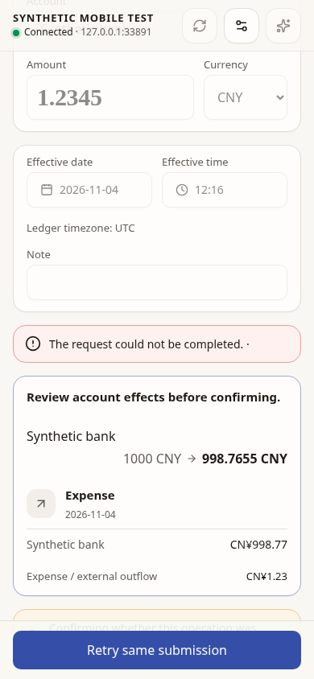
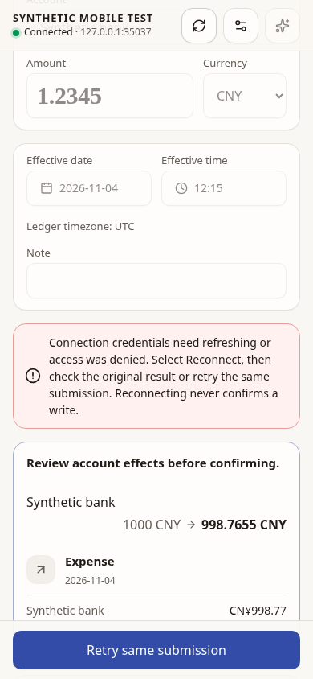

# Mobile confirmation reconnect recovery — 2026-11-04

## Scope and baseline

Baseline: latest fetched `main`, `34f048f797c4667689a729cd2324bdbd9eb005f8`.
Source acceptance: [desktop restart / stale-CSRF lockout](https://yous-corp.slack.com/archives/C0C7F3TN4MQ/p1793786072496939).

Linux Chromium at 390 × 844, production Vite bundles, real loopback HTTP,
synthetic SQLite household `SYNTHETIC MOBILE TEST`. Go 1.27.3, Node 24.22.0,
pnpm 12.14.0. All listeners and financial data are isolated fixtures; no real
ledger, external provider, LAN listener, or shared credentials are used.

A detached baseline worktree reused the new opt-in fixture restart control and
browser driver, with baseline application code and its own production bundle.
The browser remembered its synthetic login, reviewed expense `1.2345 CNY`, then
the fixture closed its listener and created a new server from the saved config
and registry. The browser tab stayed mounted throughout.

Baseline result: explicit Confirm returned `403 forbidden / permission / unknown`;
Reconnect was disabled, with zero successful confirmations. The baseline also
fails the UI assertion that Reconnect remains enabled and the API assertion that
a same-grant CSRF refresh does not cancel an accepted confirmation.



## Fixed behavior

The identical real-backend browser journey passes:

1. After restart, old CSRF returns `403 csrf_expired / csrfToken / unknown`.
2. Reconnect stays available and refreshes credentials. It sends **zero**
   confirmation requests and keeps the original amount and mounted review.
3. Explicit **Retry same submission** sends byte-identical plan/operation IDs.
   The lost in-memory plan returns `409 stale_preview / planId / unknown`.
4. Receipt absence leaves the draft guarded. The user can explicitly discard
   recovery only after affirming desktop verification. Cancelling that dialog
   leaves recovery guarded; confirming it retains input and allocates a fresh
   operation ID for a new review. No financial request is sent by the discard.
5. Only the subsequent explicit new Preview and Confirm records the expense.
   The browser observes no page errors.



The Go integration test independently covers both an operation never committed
and one committed before its response was lost. It restarts the actual listener
and registry, exercises repeated stale-CSRF attempts, refresh, missing plan,
and durable receipt lookup, and compares authoritative account data before and
after recovery. Recovery makes no extra balance change in either case.

## Reproduction commands

Activate the documented Go/Node toolchain and build the frontend first. Generate
Wails bindings in an environment with GTK/WebKit development libraries on Linux.
Then:

```sh
go test ./internal/mobileapi -run TestRestartConfirmationRecoveryNeverReplaysFinancialWrite -v
python3 tools/mobile-confirm-reconnect.py --output /tmp/mobile-reconnect-evidence
```

The driver starts and cleans up `TestMobileBrowserFixture` itself. Restart control
files exist only inside that opt-in test's private temporary directory; no product
restart endpoint is added. `--expect-lockout` verifies the unfixed application in
a separate baseline checkout, without sending a successful financial confirmation.
Output contains screenshots, a credential-free result summary, and fixture logs;
the temporary connection credential is removed with the fixture directory.

## Automated coverage and limits

- Mobile Vitest: 7 files / 78 tests pass, including stale/legacy CSRF, offline,
  immutable retry, concurrent reconnect/confirmation, credential replacement and
  late-response fencing, remembered-session cross-tab ownership, reauthentication
  receipt recovery, keyboard recovery dismissal and fresh-operation identity.
- Real HTTP + SQLite mobile API suite passes, including restart, revocation,
  permissions and durable receipt recovery.
- TypeScript, ESLint and production Vite build pass. The existing ECharts chunk
  warning remains; no dependency, accounting formula, receipt hash, or schema changes.
- Full regular checks are recorded in the PR. Initial concurrent frontend testing
  encountered unrelated History/App timing failures; exact focused reruns are
  reported separately without increasing test deadlines.
- Native Linux compile checks are separate from browser evidence. Native GUI,
  macOS packaging/Keychain/VoiceOver and physical iOS/Android were not exercised.
  Browser emulation does not establish those acceptance gates.
