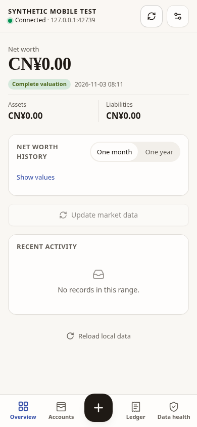

# HTTP LAN mobile verification

Implementation contract: [Private mobile access](../../design/mobile-web-access.md#direct-http-on-a-trusted-lan).

The desktop now offers explicit `http_lan` mode with an exact private numeric
listener, matching HTTP origin and no separate frontend origin. Existing settings
and default disabled state remain unchanged. The phone accepts IP:port (including
bracketed IPv6 ULA), opens the backend's built-in page, and pairs there. It never
fetches an external HTTP API from an HTTPS frontend. HTTP sessions use the existing
memory bearer and CSRF mechanism; HTTPS Secure cookies remain unchanged.

## Automated evidence

Linux cloud environment, Go 1.27.3 and Node 24.22.0:

- Full `go test ./...`, `go vet ./...` and `go build ./cmd/nestworth` passed with
  Wails' `purego` build tag. The cloud image lacks GTK4/WebKit development headers;
  this is not native desktop GUI or macOS verification.
- Unmodified Linux `go test ./internal/mobileapi` passed, including actual
  loopback HTTP requests using an isolated synthetic ledger. Coverage includes
  anonymous probe, one-use pairing, bearer-only HTTP, same-origin GET without an
  Origin header, rejected cross-origin reads, permission/CSRF rejection,
  reconnect and logout revocation. Configuration tests reject public/wildcard
  listeners, origin/listener mismatches and HTTP CORS configuration.
- Frontend lint, typecheck and production build passed. The existing documented
  ECharts vendor chunk-size warning remains.
- 83 tests across the mobile entry, connection/API transport, desktop mobile
  access settings and locale coverage passed after the final changes. These
  cover real shared input/select/button interactions, endpoint editing,
  cancellation/timeouts, invalid IP/port input, HTTP navigation guards, memory
  credentials and cryptographic UUID v4 creation without `randomUUID`.
- The full frontend run passed 1,669 tests and hit two 5-second timeouts in
  unchanged account/history tests while Go compilation/tests ran concurrently.
  Both timed-out tests passed in an isolated rerun (2 passed, 205 deselected).
  The full suite is not reported as an uninterrupted green run.

## Chromium evidence and limits

A temporary Go test harness served the production mobile build and an isolated
`SYNTHETIC MOBILE TEST` ledger on an ephemeral loopback HTTP port. Chromium used
a 390×844 viewport, without disabling web security or certificate verification.
Pairing and in-page reconnect passed; there were no JavaScript page errors,
no horizontal overflow, no cookies, and no localStorage entries after pairing.

Loopback is a browser secure-context exception (`isSecureContext: true`,
`crypto.randomUUID` present). This browser check does **not** prove ordinary
non-loopback HTTP browser or real-phone acceptance. An attempted non-loopback
synthetic hostname was blocked by the cloud proxy with
`No approved upstream IPv4 address` before reaching the application. Its policy
remained unchanged. The insecure-context UUID fallback has unit coverage using
cryptographic `getRandomValues`, without calling `randomUUID`.

Still unverified: physical iOS/Android browsers, Wi-Fi routing/client isolation,
browser local-network permissions, IPv6 network reachability and native macOS
GUI. No real household, device credentials or personal ledger was used. No
actual LAN listener, firewall/router change, public exposure, deployment or merge
was performed. Enabling LAN access later requires the owner's explicit desktop
selection of a trusted network, concrete IP and port; unencrypted transport is
explained before applying settings.
