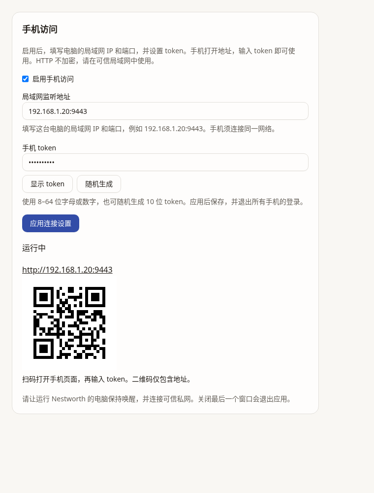
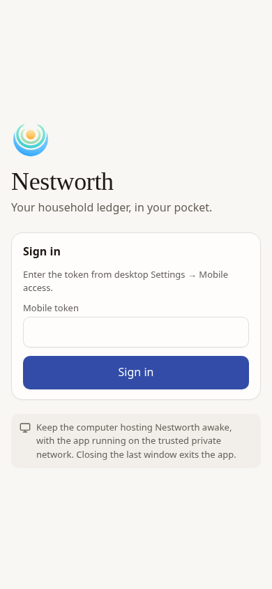
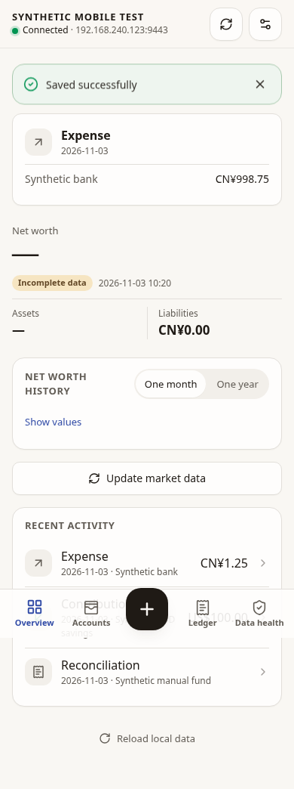

# Simple LAN mobile access verification

Contract: [LAN mobile access](../../design/mobile-web-access.md).

Desktop setup now consists of an enable switch, the computer's numeric LAN
IP:port and a reusable token. The phone opens that address and signs in with the
token. HTTPS, certificate/key, HTTPS proxy, separate frontend/CORS, backend
selection and one-use pairing were removed. The default remains off.

Version-2 settings persist the shared token in a private file. Existing settings
are retained on disk until Apply, loaded disabled, and keep only the listen
address as a draft. No ledger migration or provider/presentation changes occur.
Applying settings, shutdown and restart invalidate sessions. A valid login can
replace an old idle session so repeated reloads do not exhaust login slots.

## Automated checks

Linux cloud, Go 1.27.3, Node 24.22.0, Wails 3.1.0:

- The mobile HTTP adapter and desktop mobile service tests pass, covering
  reusable/custom/generated tokens, independent session credentials, incorrect
  token and guessing limits, Host/Origin/CSRF checks, same-origin GET without
  Origin, closed route allowlist, explicit enablement, invalid/future/legacy
  settings, token persistence, restart/change/disable revocation, immediate
  listener restart, idle-session replacement, financial receipt idempotency,
  queued revocation and body bounds.
- Final settings/mobile regression run: **13 files / 102 tests passed**. This
  includes the actual Settings page, shared controls and all locales. The
  unrelated global preference footer is hidden on Mobile access unless another
  tab has an unsaved preference draft; that draft remains saveable.
- Final full frontend suite: **162 files / 1,648 tests passed** in 275.27s.
  Frontend lint, TypeScript checking and production build pass. The existing
  ECharts vendor chunk-size warning remains. Generated bindings and build output
  are not committed.
- Native Linux container: `go build ./cmd/nestworth`, `go vet ./...` and
  `go test ./cmd/nestworth` pass with GTK4/WebKit development libraries.
- The packaged production mobile PNG check passes using the same embedded assets
  and HTTP handler as the app.
- The first complete Go run on the outer cloud image could not compile the
  desktop command because GTK/WebKit headers are absent there; the native
  container command check above closes that compile/test gap. That run also
  failed the existing `TestAnalysisPerformanceBudgets/cold-2y`: 10.204s against
  its unchanged 5s budget while compilation and frontend tests ran concurrently.
  Other Go packages passed. An isolated, unchanged-budget recheck passes all
  three cases; cold 2Y computation is 1.681s (test 1.925s total). This supports
  resource contention as the cause, but the earlier full run remains recorded
  as failed rather than an uninterrupted green run.

## Browser evidence

Chromium 154.0.8037.57, 390×844 touch viewport, synthetic household only:

- Real loopback HTTP: token-only login, incorrect-token rejection, login,
  reviewed expense preview/confirmation, reload/relogin with the same token,
  reconnect and logout pass. No cookies, stored credentials, horizontal overflow
  or JavaScript page errors were observed.
- Insecure-context frontend: the same flow passes at an invented HTTP origin
  with `isSecureContext === false`, no `crypto.randomUUID`, and working
  `crypto.getRandomValues`. Playwright intercepts every request and forwards only
  to the isolated loopback fixture, rewriting Host/Origin for that fixture.
  This tests actual browser insecure-context behavior, not physical LAN routing;
  Host/Origin rejection has independent direct HTTP test coverage. No browser
  web-security or certificate verification flags were disabled.
- A direct private cloud-IP browser attempt returned an upstream connection
  termination before reaching the page. The supported network policy was not
  changed. It does not establish ordinary LAN reachability.
- Desktop settings screenshot/interactions use the real React section and shared
  controls with a synthetic desktop-service stub, not a native desktop process.
  Custom token, random token, hide/show and explicit Apply pass.

## Limits

HTTP is plaintext by design; token authentication does not encrypt traffic.
Generated tokens have 50 random bits; custom tokens may be predictable. The
shared token is stored in plaintext in a mode-0600 settings file so desktop can
show/edit it. This file is excluded from Nestworth's ledger/settings backup
archive, but filesystem-level copies may include it.

Real iOS/Android, Wi-Fi routing/client isolation, browser local-network prompts,
IPv6 reachability and native macOS GUI remain unverified. No actual device
network/security settings, real ledger or user credentials were touched. No
release or merge is part of this change. Exact pushed head and CI run are
reported on the PR; native Mac CI is separate from manual GUI acceptance.
