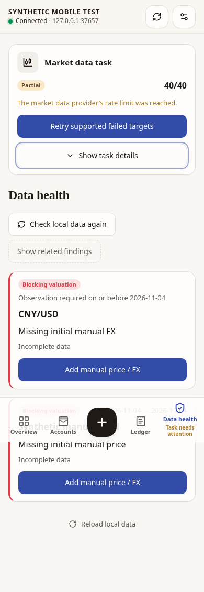
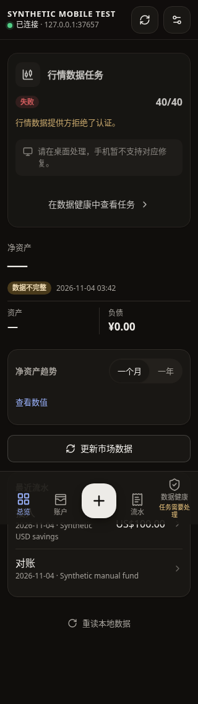

# Mobile access validation and compact task QA — 2026-11-04

Base: `1701e5d` (main). This record accompanies the implementation commit.
The repository has no `.agents/skills`; root/frontend guidance and the maintained
engineering, local workflow and shared-control contracts were followed.

## Initial implementation automated evidence (`01794cf`)

Environment: Linux amd64, Go 1.27.3, Node 24.22.0, pnpm 12.14.0. Wails 3.1.0
bindings and native Linux checks ran in the existing GTK4/WebKitGTK build
container. The host lacks those development libraries; the container completed
the checks without changing application dependencies or build configuration.

| Check | Result |
| --- | --- |
| `go test ./...` | Passed, 50 packages including packages with no tests |
| `go vet ./...` | Passed |
| Linux `go build ./cmd/nestworth` | Passed, also repeated after the final frontend bundle |
| `gofmt -l cmd internal` | Empty |
| `pnpm run typecheck` | Passed |
| `pnpm run test` | 163 files / 1691 tests passed |
| Final focused mobile/settings/wire-error/locales tests | 4 files / 59 tests passed |
| `pnpm run build` | Passed; existing large vendor-chunk warning remains |
| `pnpm run lint` | Passed, including 15 locale coverage tests |
| `git diff --check` | Passed |

The configuration regressions use the real Input, Button, error translation and
FieldError components with a mocked desktop binding. They cover rejected
wildcard addresses in all three languages, accessible error association, draft
retention, clearing the error after an edit and token validation. Existing Go
configuration tests still reject unspecified/public addresses, hostnames,
noncanonical addresses/ports and invalid tokens while accepting private IPv4,
private IPv6 and loopback. Backend validation is unchanged.

Task regressions cover running/queued, succeeded, partial, failed and cancelled
results; keyboard disclosure; visible causes, cooldown and desktop action;
cancellation and failed status reads; immutable acceptance recovery; task-pinned
pagination and a newly observed task starting collapsed. A shared task can
complete while Accounts is selected, update the navigation status and invalidate
health/overview without starting new provider work.

## Browser evidence

Playwright 1.64.1 with Chromium 154.0.8037.57 exercised the production mobile
bundle over the existing opt-in `TestMobileBrowserFixture` HTTP server. That
fixture creates a fresh temporary SQLite ledger with the explicit
`SYNTHETIC MOBILE TEST` household and synthetic accounts/instruments. Only task
GET responses were replaced with synthetic state snapshots; session/login,
bootstrap, account, activity, overview and health reads used the actual fixture.
No real ledger, provider credentials or live provider refresh was used.

Checked English at 390px/light, Simplified Chinese at 320px/dark and Traditional
Chinese at 390px/light (844px viewport height). Each checked:

- Shared running work continues polling while Accounts/Ledger omit the card.
- Partial results expose their rate-limit cause and retry action before details.
- Forty target rows stay hidden until keyboard expansion and can be collapsed.
- A successful refresh removes the Overview card; failure makes it visible again.
- No horizontal overflow and no uncaught page errors.

The partial task card was approximately 250 CSS pixels high in these samples,
independent of its forty hidden rows. This is layout evidence, not a rendering
speed or general performance claim. The existing polling cadence is unchanged.

Screenshots below contain only fixture data. They are newly captured evidence,
not copies of the private reference image.

[English partial task, 390px/light](partial-task-en.png)

[Simplified Chinese failed task, 320px/dark](failed-task-zh-CN.png)

## Limits

Chromium mobile emulation and jsdom do not establish physical iPhone/Safari or
native macOS GUI acceptance. Native application launch/relaunch, packaging,
signing and notarization were not performed. Shared task state changes in the
browser were synthetic; provider admission, ownership, cancellation and retry
contracts retain the existing Go tests and backend behavior.

## Pinned-detail follow-up

Independent review identified that a pinned successful task could remain the
active query after its details were hidden, suppressing new shared task status.
Four added regression cases failed against `01794cf` at the missing running
navigation signal: leaving paged details for Accounts, Ledger or Overview, and
collapsing details in Data health. The fixture returns distinct old/pinned and
new/current tasks, so re-reading the old job cannot accidentally satisfy them.

The pin and cursor now apply only inside expanded Data health details. Leaving
that tab switches the query to `current` immediately and clears the old disclosure
and pagination state; collapsing details also releases the pin. Expanded detail
pagination remains tied to its task. No second polling observer or provider work
was added.

Follow-up validation: all 35 MobileApp tests passed, including the four new cases
and existing pagination/first-page, cancellation, immutable acceptance and error
coverage. Typecheck, production build and lint passed. The original full-suite
and Go evidence above belongs to `01794cf`; backend behavior is unchanged in this
follow-up and the latest pushed head has its own native macOS CI run.

The final production bundle was also checked in Chromium at 390px against the
synthetic HTTP/SQLite fixture, with separate old-successful and new-current task
responses. For all four exit paths, subsequent task reads used only
`/market-jobs/current?cursor=`; real timer polling exposed the new running task
and then its failed/authentication state. Accounts/Ledger retained no card;
returning to Data health showed the new failure with collapsed details. The old
pinned response stayed successful throughout. No uncaught page errors occurred.
